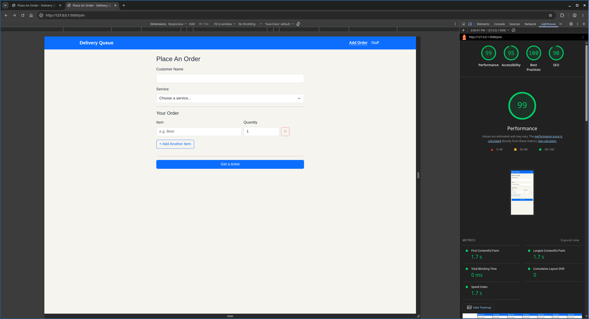
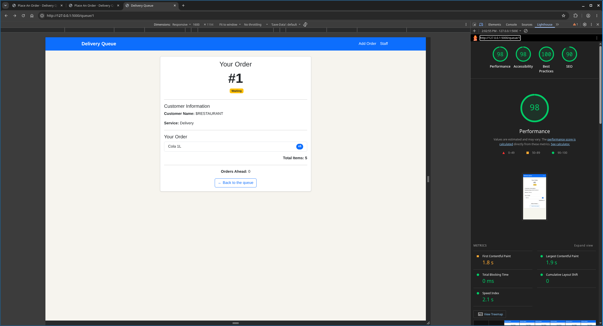
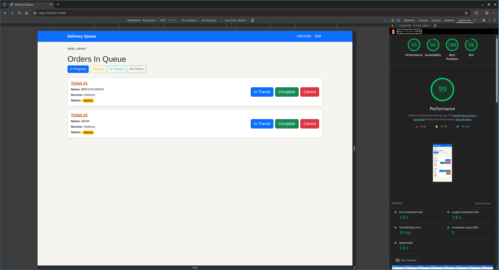

## 9a. Lighthouse (Accessibility, Mobile)

| Screen          | Score | Screenshot                                           |
| ---             | ---   | ---                                                  |
| Join the queue  | 95    |        |
| My place        | 98    |   |
| Staff dashboard | 94    |      |
|                 |       |                                                      |

Issues: Low Contrast In Buttons like Status Filters Buttons

## 9b. Keyboard Only
Join the queue from the home page: Visible. Button that directs to homepage shows an underline when keyboard test is done
On the staff dashboard, filter by a service, call a ticket, and serve it: Service filters show a highlight where the stroke color fills the shape. Serving shows an outline to show what ticket 

## 9c. Manual checklist
| Check                                                                | Join | My place | Staff                                       |
| ---                                                                  | ---  | ---      | ---                                         |
| Every input has a visible label                                      | ✅   | ✅       | ✅                                          |
| Error messages say what to do, in text                               | ✅   | ✅       | ✅                                          |
| Status is shown in words, not only color                             | ✅   | ✅       | ✅                                          |
| Text and buttons are readable at 375 px with no sideways page scroll | ✅   | ✅       | ❌(Added scroll bar next to tickets in CSS) |
| Buttons are at least about 44 × 44 px on a phone                     | ✅   | ✅       | ✅                                          |
| Page has one `<h1>` and headings in order                            | ✅   | ✅       | ✅                                          |
| `<html lang="en">` (or your language) is set                         | ✅   | ✅       | ✅                                          |

