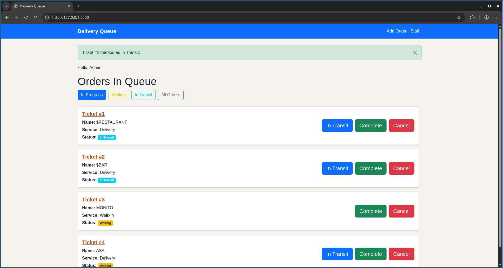
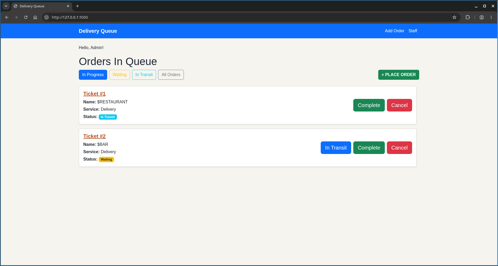

# Usability Test
Participant: My mother who runs a shop for selling soft drinks
Date: November 16, 2026

## Tasks
Did they finish it? Yes
Duration: 5 mins
Where they hesitated: 
- Adding an order. order creation button is too far away and small

Which persona rules did hold up:
- User interface lets business owner change order status independently of ticket order creation

## Improvement 10b
Orders already marked In Transit still have the button for it that does not do anything when clicked.

Before:

After:

