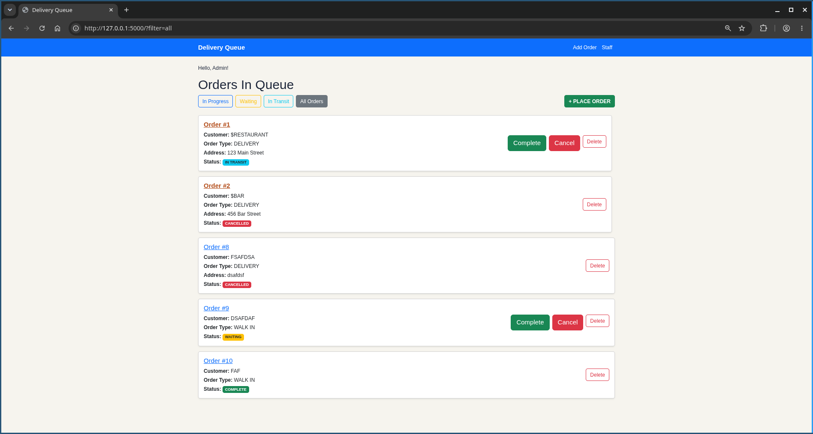
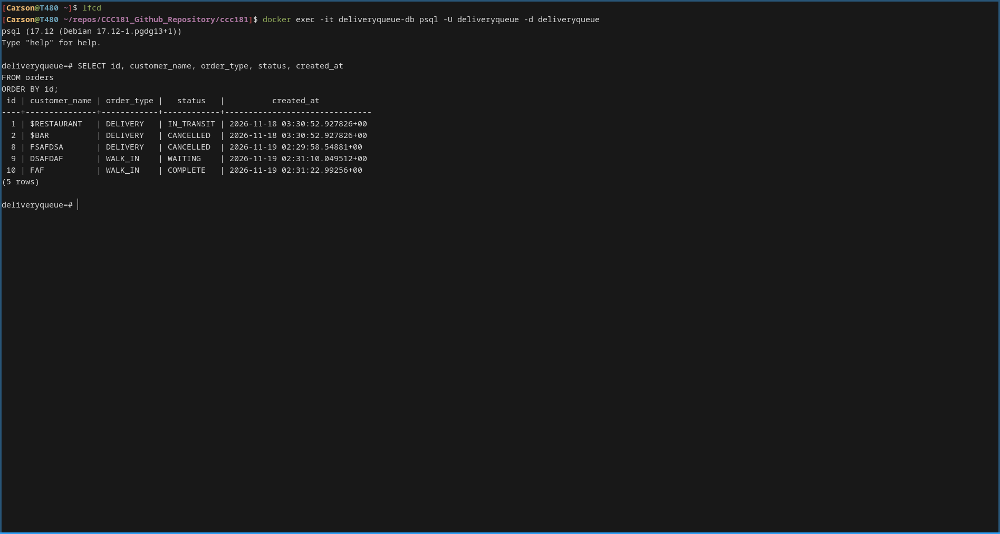

# Restart Test:

## Create at least five tickets across at least two services. Call one, serve one, and let one person leave.


## 📷 The staff dashboard, and the result of SELECT id, status, service_id, created_at FROM tickets ORDER BY id; in psql.
Website:


Psql:
Using the query:
```
SELECT id, customer_name, order_type, status, created_at
FROM orders
ORDER BY id;
```



## Stop Flask with Ctrl+C. Run docker compose down. Run docker compose ps and see that nothing is running.

## Run docker compose up -d, wait until docker compose ps says healthy, then start Flask again.

##📷 The same dashboard and the same SQL query. Every ticket, status and time must be exactly as before.

Website:


Psql:
Using the query:
```
SELECT id, customer_name, order_type, status, created_at
FROM orders
ORDER BY id;
```


