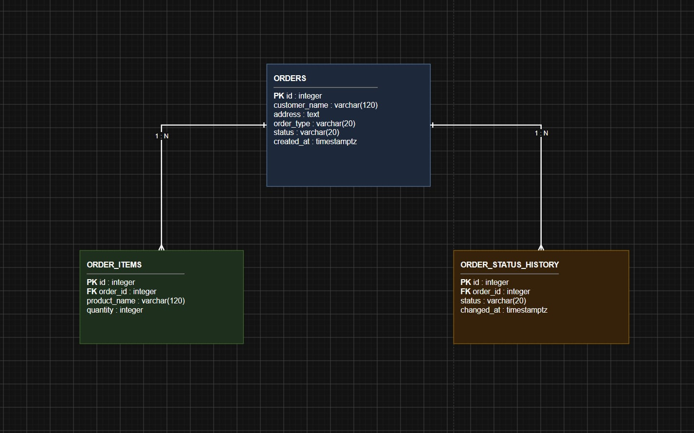
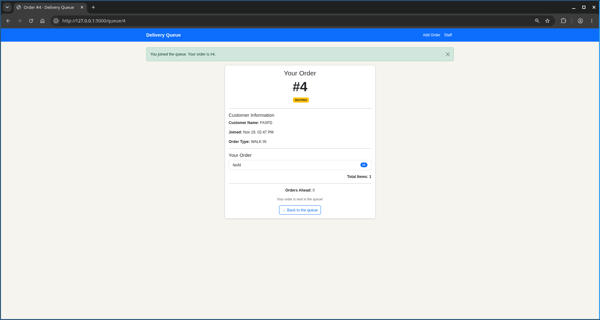
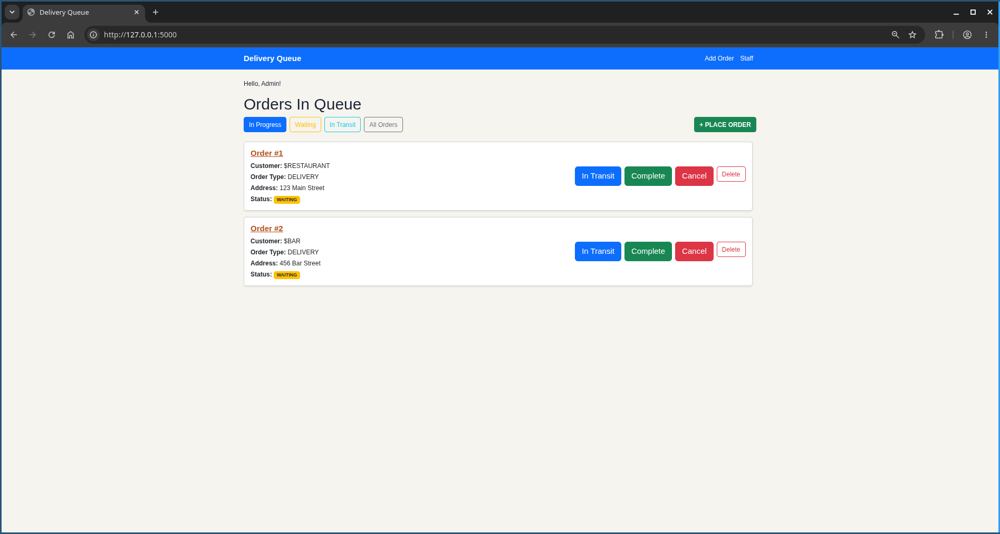
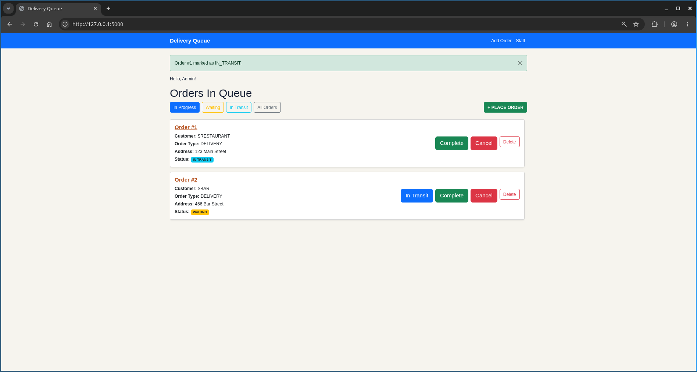
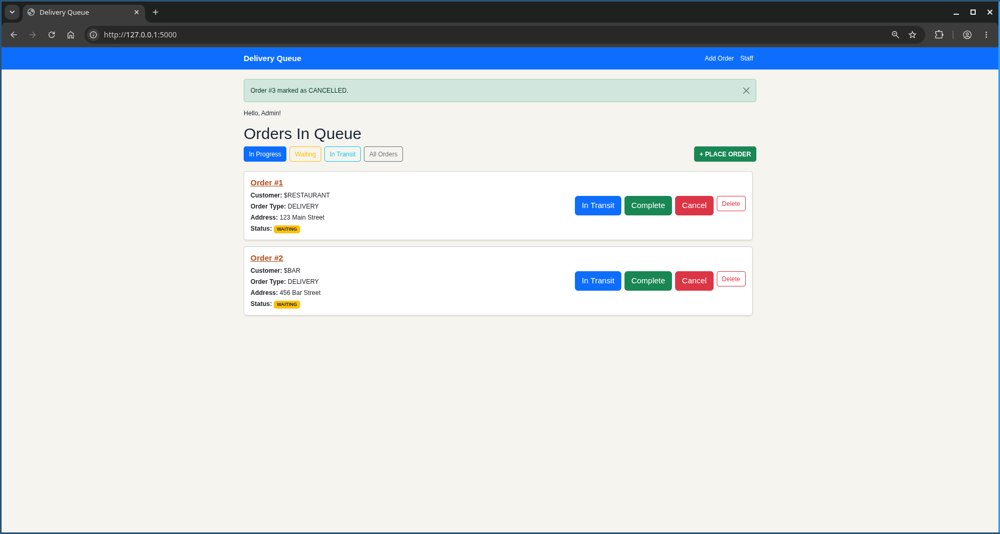
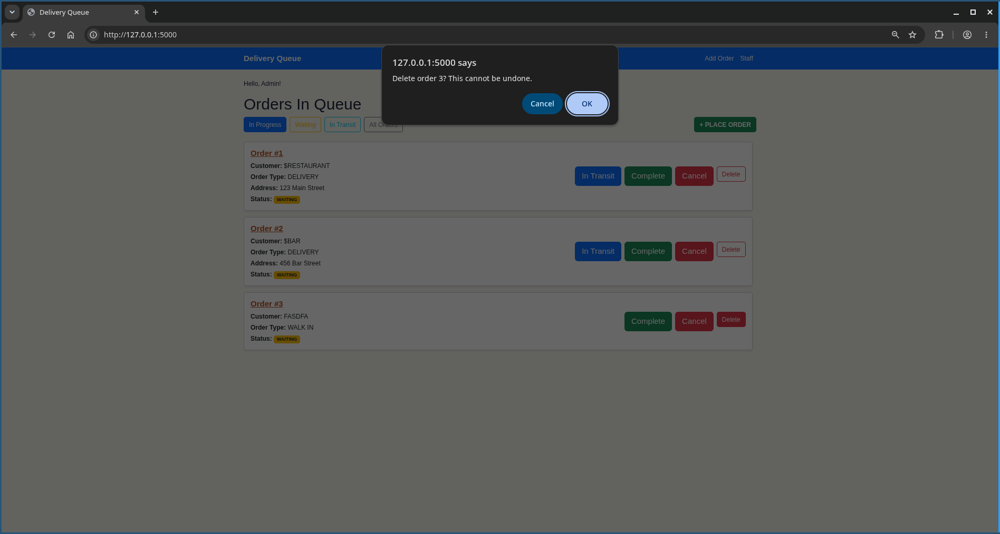
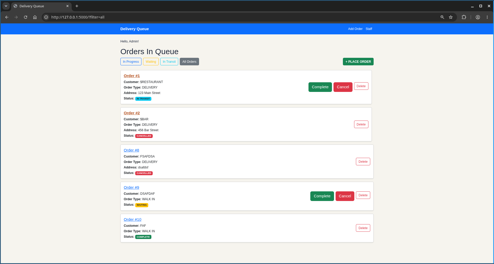
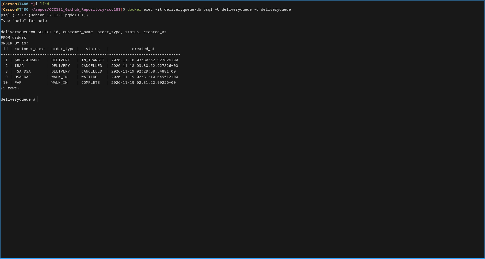

## Title Details
Name: Delivery Queue
Setting: Warehouses that take walk ins and deliveries
Student Name: Charlson Fabrigar
ID: 2024-0796
Date: Nov 19, 2026

## Requirements
Functional Requirements: 10
Non Functional Requirements: 4

MVP:

| ID    | Requirement                                                                         | Priority | Stores Data | Status        |
| ---   | ---                                                                                 | ---      | ---         | ---           |
| FR-01 | Push an order to the Queue                                                          | Must     | Yes         | Done (Week 3) |
| FR-02 | Check Pending Orders                                                                | Must     | Yes         | Done (Week 3) |
| FR-03 | View Order Details                                                                  | Must     | Yes         | Done (Week 3) |
| FR-04 | Mark order as Complete                                                              | Must     | Yes         | Done (Week 3)              |
| FR-05 | Mark order as Cancelled                                                             | Must     | Yes         | Done (Week 3)              |
| FR-06 | Mark order as IN_TRANSIT                                                            | Must     | Yes         | Done (Week 3)              |
| FR-07 | Name and address are separate ★                                                     | Must     | Yes         | Later                      |
| FR-08 | System rejects any attempt to register a Walk-In service as IN_TRANSIT ★            | Must     | Yes         | Later                      |
| FR-09 | Filter Orders that are in progress (i.e orders with a WAITING or IN_TRANSIT status) | Must     | No          | Done (Week 3)              |
| FR-10 | Walk-In Orders have no address  ★                                                   | Must     | Yes         | Later                      |

**Out of Scope:**
1. Inventory Management, system only needs to know items only belong to a particular ticket
2. Customer Registration, system only needs basic customer identification like name and address. Maintaining customer profiles is not necessary for order processing 

## ERD


One order contains many order items. Each order item belongs to 1 order
One order can have many status history records. Each status history record belongs to 1 order

| Table                | Delivery Queue Columns                                                   |
| ---                  | ---                                                                      |
| order                | order.name, order.address, order.service, order.status, order.created_at |
| order_item           | order_item.name, order_item.quantity                                     |
| order_status_history | order_status_history.status, order_status_history.changed_at             |a

## Schema

Orders:

```
                                        Table "public.orders"
    Column     |           Type           | Collation | Nullable |              Default
---------------+--------------------------+-----------+----------+------------------------------------
 id            | integer                  |           | not null | nextval('orders_id_seq'::regclass)
 customer_name | character varying(120)   |           | not null |
 address       | text                     |           |          |
 order_type    | character varying(20)    |           | not null |
 status        | character varying(20)    |           | not null | 'WAITING'::character varying
 created_at    | timestamp with time zone |           | not null | now()
Indexes:
    "orders_pkey" PRIMARY KEY, btree (id)
Check constraints:
    "ck_orders_address_by_order_type" CHECK (order_type::text = 'WALK_IN'::text AND address IS NULL OR order_type::text = 'DELIVERY'::text AND address IS NOT NULL AND length(TRIM(BOTH FROM address)) > 0)
    "ck_orders_order_type" CHECK (order_type::text = ANY (ARRAY['DELIVERY'::character varying, 'WALK_IN'::character varying]::text[]))
    "ck_orders_status" CHECK (status::text = ANY (ARRAY['WAITING'::character varying, 'IN_TRANSIT'::character varying, 'COMPLETE'::character varying, 'CANCELLED'::character varying]::text[]))
Referenced by:
    TABLE "order_items" CONSTRAINT "order_items_order_id_fkey" FOREIGN KEY (order_id) REFERENCES orders(id)
    TABLE "order_status_history" CONSTRAINT "order_status_history_order_id_fkey" FOREIGN KEY (order_id) REFERENCES orders(id)
```

Order Items:

```
                                       Table "public.order_items"
    Column    |          Type          | Collation | Nullable |                 Default
--------------+------------------------+-----------+----------+-----------------------------------------
 id           | integer                |           | not null | nextval('order_items_id_seq'::regclass)
 order_id     | integer                |           | not null |
 product_name | character varying(120) |           | not null |
 quantity     | integer                |           | not null |
Indexes:
    "order_items_pkey" PRIMARY KEY, btree (id)
Check constraints:
    "ck_order_items_quantity" CHECK (quantity > 0)
Foreign-key constraints:
    "order_items_order_id_fkey" FOREIGN KEY (order_id) REFERENCES orders(id)
```

Order Status History:

```
                                       Table "public.order_status_history"
   Column   |           Type           | Collation | Nullable |                     Default             
------------+--------------------------+-----------+----------+--------------------------------------------------
 id         | integer                  |           | not null | nextval('order_status_history_id_seq'::regclass)
 order_id   | integer                  |           | not null |
 status     | character varying(20)    |           | not null |
 changed_at | timestamp with time zone |           | not null | now()
Indexes:
    "order_status_history_pkey" PRIMARY KEY, btree (id)
Check constraints:
    "ck_order_status_history_status" CHECK (status::text = ANY (ARRAY['WAITING'::character varying, 'IN_TRANSIT'::character varying, 'COMPLETE'::character varying, 'CANCELLED'::character varying]::text[]))
Foreign-key constraints:
    "order_status_history_order_id_fkey" FOREIGN KEY (order_id) REFERENCES orders(id)
```

## Design Decisions
1. Separate Address Field- One person in the field said that names of regular customers can sound similar. Address field for deliveries separates them
2. Empty Address Field for Walk-Ins- business address serves as the address. The destination in this case is the counter or outside the warehouse
3. Single Cancelled in place of LEFT- Cancelled is an umbrella term that can cover multiple reasons like out of stock, customers leaving, etc. Prevents UI from becoming cluttered  
  
## Self Review
has the ff check constraints:
    - Orders only use valid types and statuses
    - WALK_IN orders do not have addresses
    - DELIVERY orders must have a non-empty address
    - Status history only contains valid statuses


## Migrations
1. Initial Tables - initial tables like order, order_item, order_status_history 
2. Business Rules - checks for null addresses. Walk-In orders must have null addresses 


## CRUD
| Operation   | Screenshot                                          | Route                                      |
| ---         | ---                                                 | ---                                        |
| Create      |            | POST /join                                 |
| Read        |                | GET /                                      |
| Update      |            | POST  /tickets/<int:ticket_id>/<action>    |
| Soft Delete |  | POST /tickets/<int:ticket_id>/<action>     |
| Hard Delete |  | GET  /staff/tickets/<int:ticket_id>/delete |

 
## Validation
Mostly business rules related to handling the address. For walk-ins, address stays null. check constraints fail and reject the input at a database level one tries to insert walk-in orders with an address. [validation](validation.md)

## Persistence

Before: 
    Website:
    

    Psql:
    Using the query:
    ```
    SELECT id, customer_name, order_type, status, created_at
    FROM orders
    ORDER BY id;
    ```

    

After:
    Website:
    

    Psql:
    Using the query:
    ```
    SELECT id, customer_name, order_type, status, created_at
    FROM orders
    ORDER BY id;
    ```
    

Rebuild from scratch:


## Reflection
Setting up docker for linux was hard. Adding a status history table was the most tedious to implement (NFR-03) because of deciding what to put in it has scope creep. for now, it has a date and a status. testing was done thru PSQL because there's no frontend to access the history yet. Staff would want to know how soon an order got cancelled.  

## Declaration
GPT-6 was used throughout implementing the steps.  
