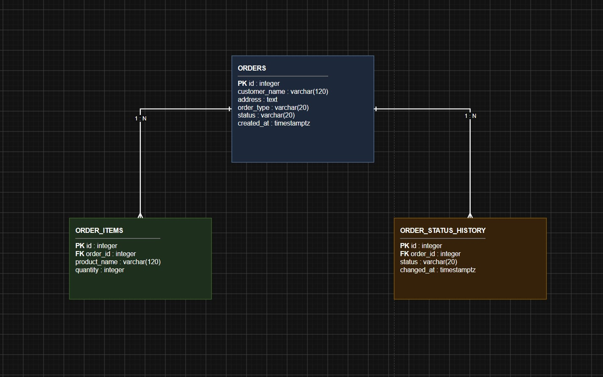

# Schema

## Find nouns

| Req ID | Requirement                      | Noun          | Table or Column           |
|--------|----------------------------------|---------------|---------------------------|
| FR-01  | Push an Order to Queue           | order         | order                     |
| FR-07  | Names and Addresses are separate | name, address | order.name, order.address |
| NFR-07  | System history that records date and time when an order's status is changed  | date, time | order.name, order.address |a

## List Tables and Columns

| Table                | Delivery Queue Columns                                                   |
| ---                  | ---                                                                      |
| order                | order.name, order.address, order.service, order.status, order.created_at |
| order_item           | order_item.name, order_item.quantity                                     |
| order_status_history | order_status_history.status, order_status_history.changed_at             |a

## Choose Types and Constraints:
| Table | Column | PostgreSQL type | Constraint | Why |
|---|---|---|---|---|
| orders | id | integer, generated | PRIMARY KEY | Unique identifier generated by the database |
| orders | customer_name | varchar(120) | NOT NULL | Identifies who placed the order |
| orders | address | text | NULL allowed | Delivery destination; optional for walk-in orders |
| orders | order_type | varchar(20) | NOT NULL, CHECK (order_type IN ('DELIVERY', 'WALK_IN')) | Only allows valid order types |
| orders | status | varchar(20) | NOT NULL, CHECK (status IN ('WAITING', 'IN_TRANSIT', 'COMPLETE', 'CANCELLED')) | Prevents invalid order statuses |
| orders | created_at | timestamptz | NOT NULL DEFAULT now() | Records when the order was created |
| order_items | id | integer, generated | PRIMARY KEY | Unique identifier for each order item |
| order_items | order_id | integer | NOT NULL REFERENCES orders(id) | Ensures every item belongs to an existing order |
| order_items | product_name | varchar(120) | NOT NULL | Identifies the ordered product |
| order_items | quantity | integer | NOT NULL, CHECK (quantity > 0) | Prevents zero or negative quantities |
| order_status_history | id | integer, generated | PRIMARY KEY | Unique identifier for each status history entry |
| order_status_history | order_id | integer | NOT NULL REFERENCES orders(id) | Identifies which order had its status changed |
| order_status_history | status | varchar(20) | NOT NULL, CHECK (status IN ('WAITING', 'IN_TRANSIT', 'COMPLETE', 'CANCELLED')) | Records a valid order status |
| order_status_history | changed_at | timestamptz | NOT NULL DEFAULT now() | Records when the status change occurred |

##ERD

